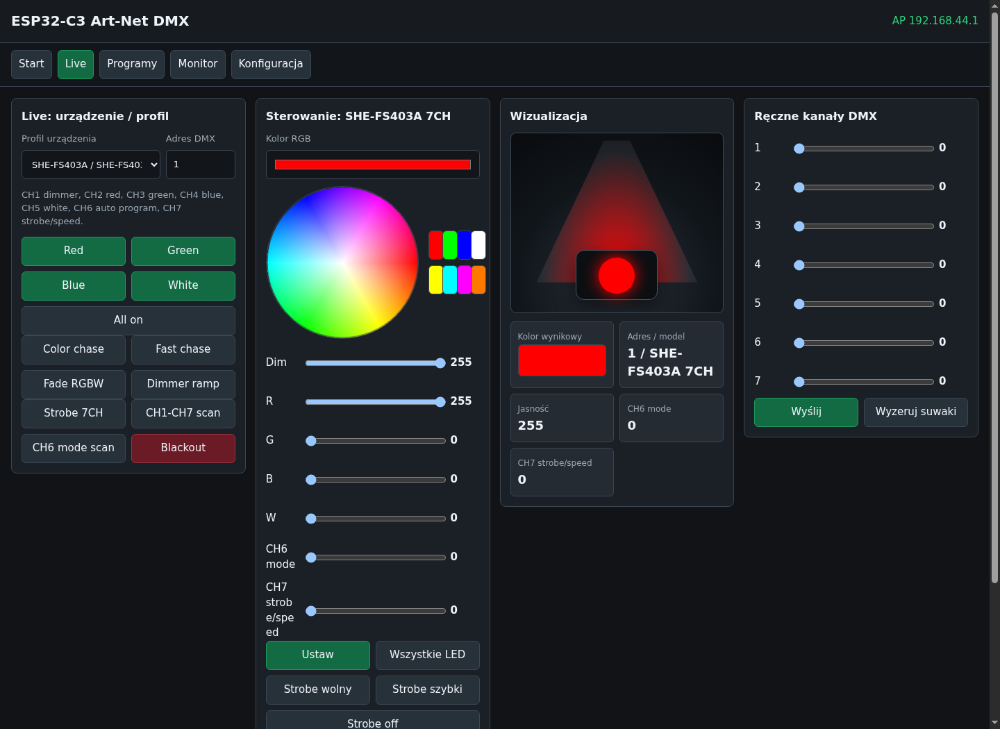
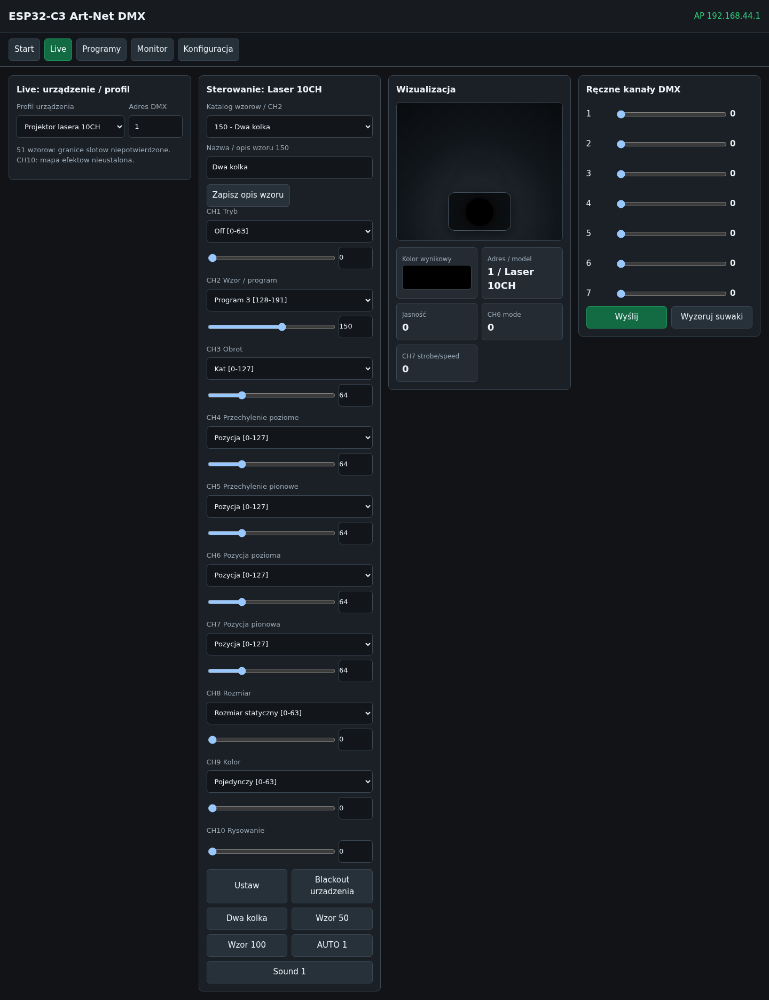
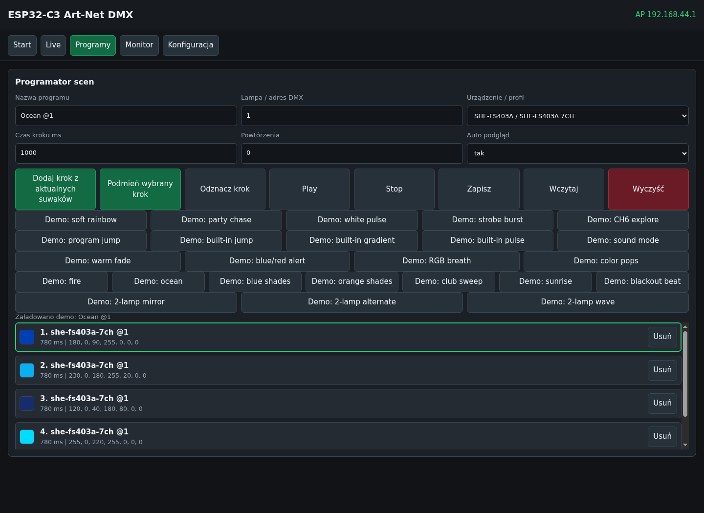
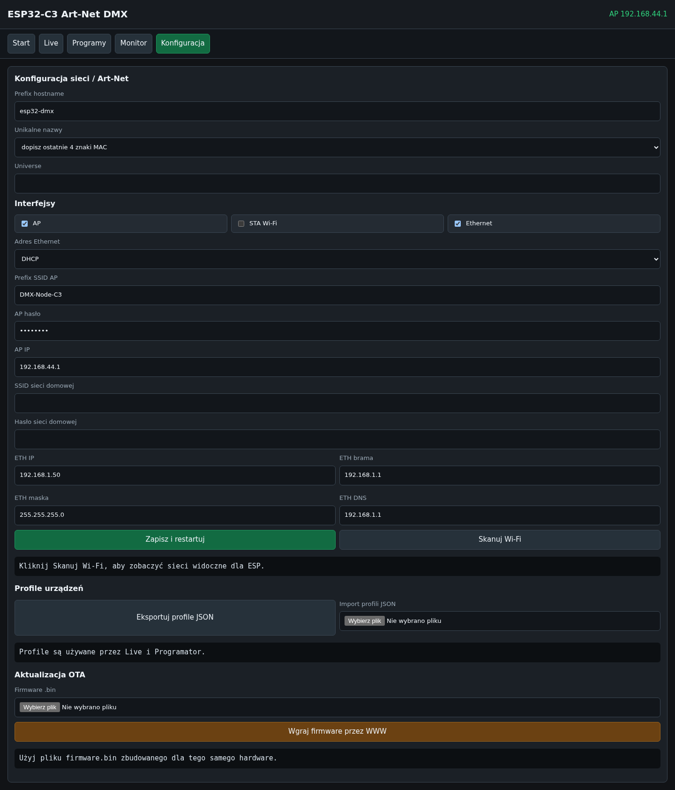
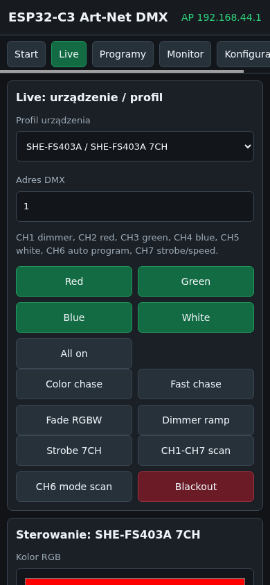
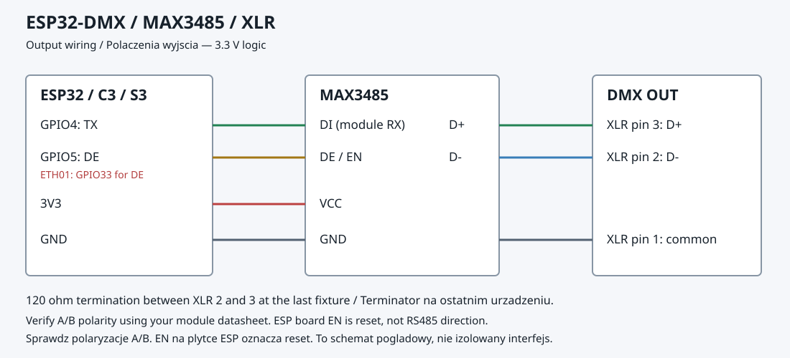

# ESP32-DMX

[Polski](README.md) | **English**

An ESP32 Art-Net to DMX512 node with a built-in web application, fixture profiles, scene programming, Wi-Fi, optional Ethernet and browser-based OTA updates. No cloud service is required.



## Features

- One DMX512 output universe: 512 channels, 250 kbaud, 8N2, continuously transmitted from a buffered UART task.
- Art-Net ArtDMX input and ArtPoll discovery over UDP 6454; configurable zero-based universe.
- Wi-Fi access point and station operation; LAN8720 Ethernet on ESP32-ETH01, including optional automatic Wi-Fi fallback.
- Responsive web panel: Start, Live, Programs, Monitor and Configuration.
- **Fixture profile management:** built-in RGBW, RAW and 10-channel laser profiles; custom channel labels, value ranges, defaults, named scenes and fixture blackout values.
- **Import/export fixture profiles as JSON.** Imported profiles are stored in ESP32 NVS and remain available after reboot and from another browser.
- **Scene/program management:** record channel states, edit or remove steps, select fixture addresses and profiles, set step durations, loop playback and save/load named programs in browser localStorage.
- **Named scenes inside fixture profiles:** reuse preset channel arrays and distribute them with exported profiles.
- Pattern catalog: give raw pattern-channel values descriptive names and store them in the device profile.
- HTTP API for direct channel ranges, profiles, status, demos, configuration and updates.
- Browser OTA firmware upload, live counters and diagnostic logs.
- Optional Docker Art-Net tester in [`artnet-tester`](artnet-tester/README.en.md).

## Devices and Control Trials

The project supports RGB/RGBW fixtures, lighting circuits through external DMX dimmer packs and other devices described by channel profiles. ESP32 sends DMX; it does not directly regulate mains voltage.

| SHEHDS LED PAR 54 x 3 W RGBW | Robe Pointe |
| --- | --- |
| <a href="https://shehds.com/products/fast-shipping-led-54x3w-rgbw-led-flat-par-rgbw-color-mixing-dj-wash-light-stage-uplighting-ktv-disco-dj-dmx512"></a> | <a href="https://www.robe.cz/pointe"></a> |
| Project notes document **SHE-FS403A 7CH** testing: RGBW, dimmer, programs and strobe. The image illustrates the catalog family; verify the channel mode against your own fixture manual. | Response to **grandMA3 / OSC** control (`1 At 50`) was confirmed. This was a separate test path; this repository does not ship a Pointe profile or a grandMA3 OSC client. |
| [Manufacturer product page](https://shehds.com/products/fast-shipping-led-54x3w-rgbw-led-flat-par-rgbw-color-mixing-dj-wash-light-stage-uplighting-ktv-disco-dj-dmx512) · [SHEHDS manuals](https://shehds.com/pages/user-manual-download) · [Photo source](https://www.ebay.com/itm/286060053321) | [Robe product page and documents](https://www.robe.cz/pointe) |

**Generic laser projector 10CH:** pattern display, size changes and drawing modes were observed through this Art-Net/DMX node. The `laser10` profile and JSON example are included. Its brand/model remain unconfirmed, so no unrelated product photograph is assigned to it.

**Dimmer packs:** the generic 6CH profile and Botex DPX-620 III tester demonstrate the control format for external dimmers; this is not a claim that a particular pack has been physically validated. [Test scope and sources](docs/en/devices.md).

Catalog photographs are loaded from external websites and remain the property of their respective authors/manufacturers. They are not photographs of our installation and are not covered by the source-code MIT license. External offers and images may change.

## Quick Start

1. Wire a **3.3 V MAX3485-compatible RS485 transmitter** using the [hardware guide](docs/en/hardware.md). ETH01 uses a different direction pin.
2. Install PlatformIO and build/upload the environment matching your board:

   ```sh
   pio run -e esp32-c3-devkitm-1
   pio run -e esp32-c3-devkitm-1 -t upload --upload-port /dev/ttyUSB0
   ```

3. Join `DMX-Node-C3-XXXX`, initial password `dmx12345`.
4. Open **http://192.168.44.1/**. Change the AP password and configure networking in Configuration.
5. Set the physical fixture to DMX mode. In Live select its profile and matching start address, then apply channel values.

Defaults apply to a fresh device; existing NVS configuration survives firmware updates. Wi-Fi station credentials are intentionally blank in this public source.

## Screenshots

These are actual firmware UI renders using an offline mock backend, not photographs of connected fixtures. The interface currently uses Polish labels; documentation is available in both languages.

| Laser profile and pattern catalog | Scene programmer |
| --- | --- |
|  |  |

| Configuration and profile import | Mobile controls |
| --- | --- |
|  |  |

## Documentation

| Topic | English | Polski |
| --- | --- | --- |
| Operation, profiles, scenes and troubleshooting | [User guide](docs/en/guide.md) | [Instrukcja](docs/pl/guide.md) |
| Wiring and board variants | [Hardware](docs/en/hardware.md) | [Sprzet](docs/pl/hardware.md) |
| HTTP API and Art-Net | [API reference](docs/en/api.md) | [Dokumentacja API](docs/pl/api.md) |
| Build, USB upload and OTA | [Development](docs/en/development.md) | [Budowanie i OTA](docs/pl/development.md) |



## Scope and Limitations

The firmware does not discover fixture patches through DMX or implement RDM. Profiles describe devices; their addresses must match the physical fixtures. Browser program playback needs the page to remain open. Imported profile scenes persist in NVS, while named timeline programs are stored in the current browser. DMX output holds its last buffered values when a controller stops sending; do not assume signal-loss blackout. Concurrent HTTP, Art-Net and demo writers have no priority/merge arbitration.

HTTP control, configuration, profile storage and OTA have no application authentication or TLS. Keep the node on a trusted lighting network and do not expose it directly to the Internet. Use appropriate electrical isolation for production DMX installations. Laser fixtures require suitable beam termination and operation outside occupied viewing areas; this project is not a laser safety controller.

Firmware version: **1.1.0**. Generic laser pattern boundaries and CH10 effect names are deliberately not presented as a verified manufacturer map.
