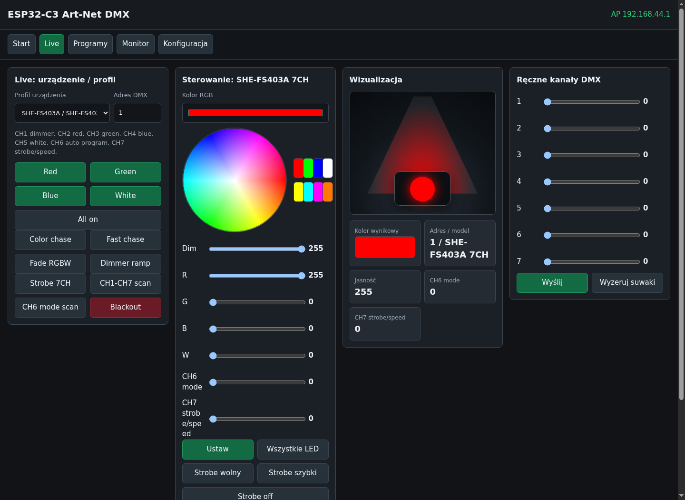
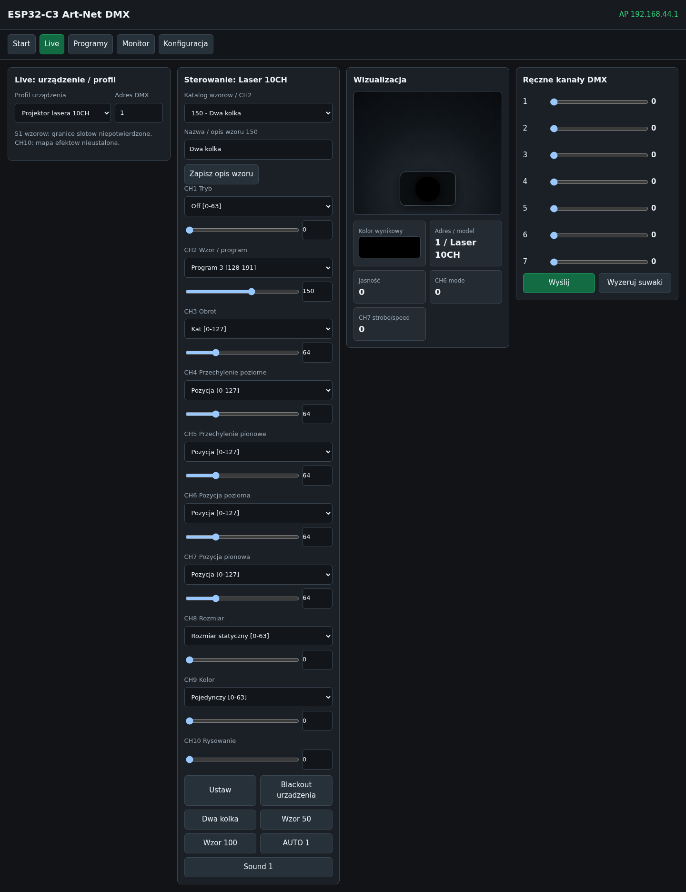
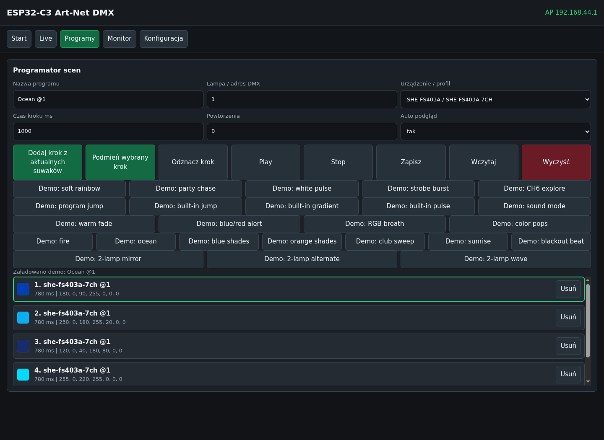
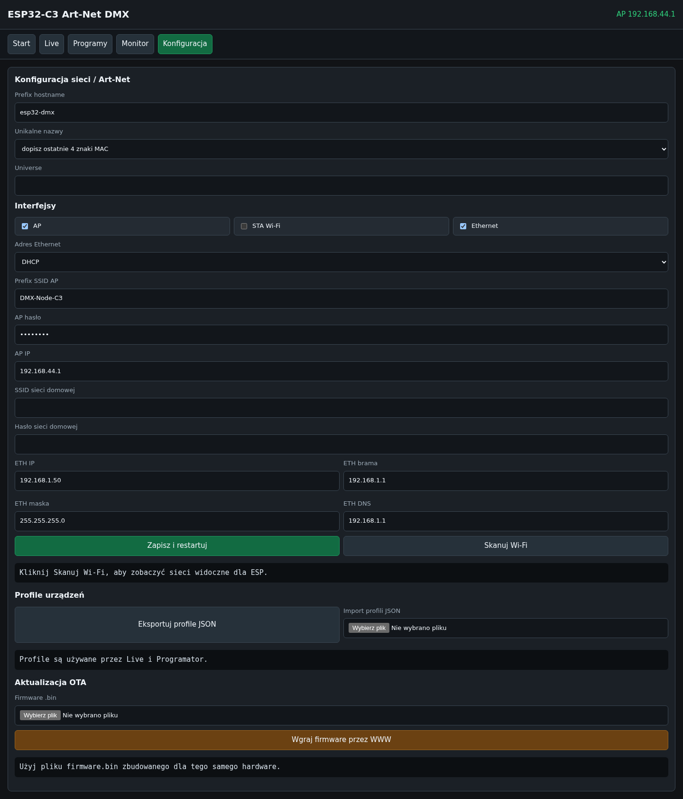
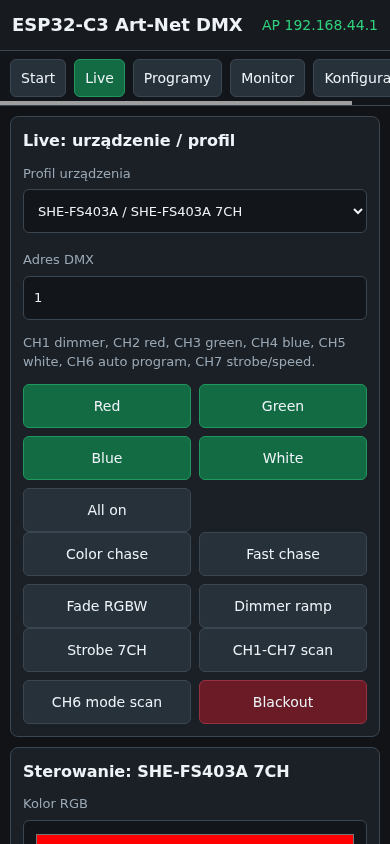
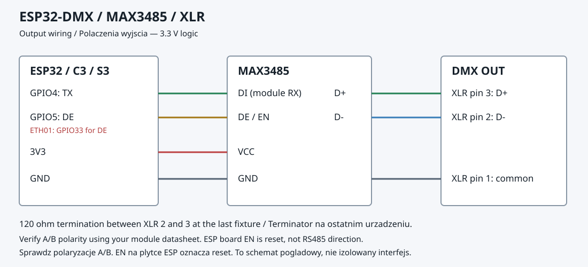

# ESP32-DMX

**Polski** | [English](README.en.md)

Sterownik ESP32 Art-Net → DMX512 z wbudowana aplikacja WWW, profilami urzadzen, programatorem scen, Wi-Fi, opcjonalnym Ethernetem i aktualizacja OTA przez przegladarke. Nie wymaga chmury.



## Funkcje

- Jedno wyjscie DMX512: 512 kanalow, 250 kbaud, 8N2, stale nadawanie bufora przez osobne zadanie UART.
- Odbior ArtDMX i wykrywanie ArtPoll przez UDP 6454; konfigurowalne universe liczone od zera.
- Wi-Fi AP i STA; Ethernet LAN8720 na ESP32-ETH01 oraz wariant z automatycznym awaryjnym Wi-Fi.
- Responsywny panel: Start, Live, Programy, Monitor i Konfiguracja.
- **Zarzadzanie profilami urzadzen:** RGBW, RAW i laser 10CH; nazwy kanalow, zakresy wartosci, ustawienia domyslne, nazwane sceny i blackout urzadzenia.
- **Import i eksport profili JSON.** Importowane profile sa zapisywane w NVS ESP32: pozostaja po restarcie i sa dostepne na innym telefonie lub komputerze.
- **Zarzadzanie scenami i programami:** nagrywanie stanu kanalow, edycja i usuwanie krokow, wybor adresu i profilu, czas kroku, petle oraz zapis/odczyt nazwanych programow w localStorage przegladarki.
- **Sceny w profilach urzadzen:** nazwane presety kanalow mozna wywolywac z panelu i przenosic razem z plikiem profilu.
- Katalog wzorow: opis wartosci kanalu wzoru jest zapisywany razem z profilem w module.
- HTTP API do kanalow, profili, statusu, demo, konfiguracji i aktualizacji.
- Aktualizacja firmware OTA przez WWW, liczniki i logi diagnostyczne.
- Dodatkowy [tester Art-Net w Dockerze](artnet-tester/README.md).

## Szybki Start

1. Podlacz nadajnik RS485 zgodny z **MAX3485 3,3 V** wedlug [schematu](docs/pl/hardware.md). ETH01 ma inny pin kierunku.
2. Zainstaluj PlatformIO i zbuduj/wgraj wariant swojej plytki:

   ```sh
   pio run -e esp32-c3-devkitm-1
   pio run -e esp32-c3-devkitm-1 -t upload --upload-port /dev/ttyUSB0
   ```

3. Polacz sie z `DMX-Node-C3-XXXX`, haslo poczatkowe `dmx12345`.
4. Otworz **http://192.168.44.1/**. Zmien haslo AP i ustaw siec w Konfiguracji.
5. Wlacz tryb DMX na lampie. W Live wybierz profil i zgodny adres startowy, ustaw wartosci i kliknij Ustaw.

To ustawienia nowego modulu. Istniejaca konfiguracja NVS pozostaje po OTA. Publiczny kod nie zawiera danych prywatnego Wi-Fi.

## Zrzuty Panelu

Zrzuty pokazuja rzeczywisty interfejs firmware z lokalnym symulatorem API. Nie przedstawiaja odczytu podlaczonych lamp. Obecny interfejs ma polskie etykiety, a dokumentacja jest polska i angielska.

| Profil lasera i katalog wzorow | Programator scen |
| --- | --- |
|  |  |

| Konfiguracja i import profili | Sterowanie mobilne |
| --- | --- |
|  |  |

## Dokumentacja

| Temat | Polski | English |
| --- | --- | --- |
| Obsluga, profile, sceny, diagnostyka | [Instrukcja](docs/pl/guide.md) | [User guide](docs/en/guide.md) |
| Polaczenia i warianty plytek | [Sprzet](docs/pl/hardware.md) | [Hardware](docs/en/hardware.md) |
| HTTP API i Art-Net | [API](docs/pl/api.md) | [API reference](docs/en/api.md) |
| Kompilacja, USB i OTA | [Budowanie](docs/pl/development.md) | [Development](docs/en/development.md) |



## Ograniczenia

Firmware nie odczytuje patcha lamp po DMX i nie implementuje RDM. Adres w panelu musi zgadzac sie z fizycznym urzadzeniem. Programator dziala w otwartej przegladarce. Profile ze scenami sa trwale w NVS; nazwane programy krokowe sa zapisane lokalnie w przegladarce. Po zakonczeniu transmisji modul utrzymuje ostatnie wartosci DMX: nie ma automatycznego blackoutu przy utracie kontrolera. HTTP, Art-Net i demo nie maja arbitrazu priorytetow ani scalania.

API, konfiguracja i OTA nie maja uwierzytelniania ani TLS. Uzywaj zaufanej sieci oswietleniowej, bez publicznego przekierowania portow. Do instalacji scenicznych zastosuj izolacje i zabezpieczenia RS485. Projekt nie jest sterownikiem bezpieczenstwa lasera; wiazka musi byc bezpiecznie zakonczona poza obszarem przebywania ludzi.

Wersja firmware: **1.1.0**. Granice 51 wzorow i nazwy efektow CH10 nie sa potwierdzona mapa producenta.
