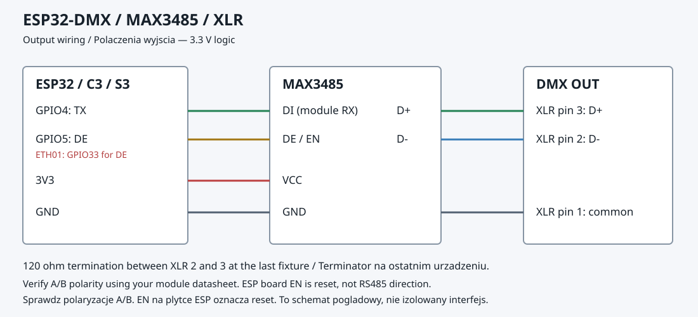
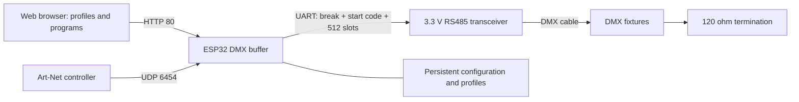

# Hardware and Wiring

[Home](../../README.en.md) | [Polski](../pl/hardware.md)

## Parts

- ESP32-C3 DevKitM-1, ESP32 Dev Module, ESP32-S3 DevKitC-1 or ESP32-ETH01.
- 3.3 V RS485 transmitter module compatible with MAX3485.
- DMX cable and suitable XLR output connector; optional 120 ohm terminator.
- Stable power supply; ETH01 programming also needs a USB to 3.3 V TTL UART adapter.

## GPIO Assignment

| Signal | ESP32 / C3 / S3 | ETH01 | Transceiver |
| --- | --- | --- | --- |
| DMX transmit | GPIO4 | GPIO4 | DI (sometimes labelled RX on the module) |
| Transmit enable | GPIO5 | **GPIO33** | DE / EN |
| Supply | 3V3 | 3V3 | VCC |
| Ground | GND | GND | GND |

The ESP32 board's EN/reset pin is not the transceiver direction signal. On modules with separate DE and /RE, DE is active high; /RE controls the receiver and may be held high for an output-only node. Check your particular module before wiring. Receiver RO/TX is not used.

## DMX Connector

| Pin | XLR 3-pin | XLR 5-pin |
| --- | --- | --- |
| 1 | Signal common / shield | Signal common / shield |
| 2 | Data negative (D-) | Data 1 negative (D-) |
| 3 | Data positive (D+) | Data 1 positive (D+) |
| 4, 5 | Not present | Unused by this output |

Match transceiver polarity using its datasheet; A/B naming is inconsistent across breakout boards. For a genuine MAX3485, the non-inverting A output corresponds to D+ and B to D-. Do not infer polarity just from an unverified module label. Connector drawings may be mirrored when viewed from the solder side; follow stamped pin numbers.

Connect fixtures in a daisy chain, and terminate the far end with 120 ohms between pins 2 and 3. Use DMX-rated twisted-pair cable. The basic module is not galvanically isolated; use an isolated transceiver, appropriate protection and a proper enclosure for stage installations. Never connect 5 V logic or true RS232 voltage levels to ESP GPIO.

## ESP32-ETH01

| LAN8720 signal | Setting |
| --- | --- |
| PHY address | 1 by default; dedicated `phy0` environment uses 0 |
| PHY power | GPIO16 |
| MDC / MDIO | GPIO23 / GPIO18 |
| Clock | GPIO0 input |
| DMX TX / direction | GPIO4 / GPIO33 |

Use an external USB-UART: adapter TX to GPIO3/RX0, RX to GPIO1/TX0, and common GND. Power the board using the board manufacturer's specified input. To flash, hold GPIO0 low during reset, upload, release GPIO0, then reset. GPIO0 also carries the Ethernet clock during normal operation.

## Architecture

