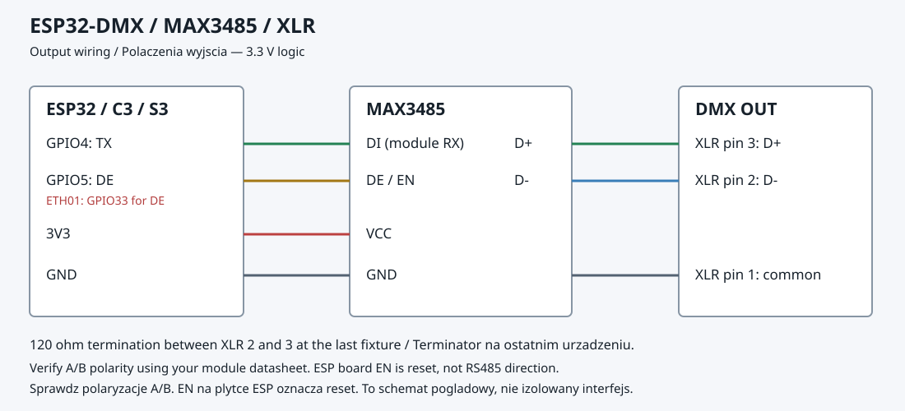
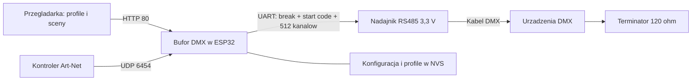

# Sprzet i Polaczenia

[Start](../../README.pl.md) | [English](../en/hardware.md)

## Elementy

- ESP32-C3 DevKitM-1, ESP32 Dev Module, ESP32-S3 DevKitC-1 albo ESP32-ETH01.
- Nadajnik RS485 zgodny z MAX3485, zasilany napieciem 3,3 V.
- Kabel DMX, odpowiednie gniazdo XLR i terminator 120 ohm na koncu linii.
- Stabilne zasilanie; do pierwszego programowania ETH01 takze USB-UART TTL 3,3 V.

## Piny

| Sygnal | ESP32 / C3 / S3 | ETH01 | Nadajnik |
| --- | --- | --- | --- |
| DMX TX | GPIO4 | GPIO4 | DI, czasem opisane RX na module |
| Kierunek nadawania | GPIO5 | **GPIO33** | DE / EN |
| Zasilanie | 3V3 | 3V3 | VCC |
| Masa | GND | GND | GND |

EN na plytce ESP to reset, nie sterowanie kierunkiem RS485. Przy osobnych DE i /RE: DE wlacza nadajnik stanem wysokim, /RE steruje odbiornikiem i moze pozostawac wysoko w module tylko nadajacym. Sprawdz schemat swojej plytki. Wyjscie odbiornika RO/TX nie jest uzywane.

## Zlacze DMX

| Pin | XLR 3-pin | XLR 5-pin |
| --- | --- | --- |
| 1 | Masa sygnalowa / ekran | Masa sygnalowa / ekran |
| 2 | D- | Data 1 D- |
| 3 | D+ | Data 1 D+ |
| 4, 5 | Brak | Nieuzywane przez to wyjscie |

Polaryzacje ustal wedlug dokumentacji transceivera. Oznaczenia A/B na roznych modulach bywaja niespojne. W samym MAX3485 wyjscie nieodwracajace A odpowiada D+, a B odpowiada D-. Patrz na numery stykow zlacza, poniewaz widok od strony lutowania jest lustrzany.

Lampy lacz szeregowo; na ostatniej zastosuj 120 ohm miedzy pinami 2 i 3. Uzywaj skretki przeznaczonej do DMX. Prosty MAX3485 nie daje izolacji galwanicznej. Do pracy scenicznej zastosuj izolowany RS485, zabezpieczenia i obudowe. Nie podawaj na GPIO logiki 5 V ani sygnalow prawdziwego RS232.

## ESP32-ETH01

| LAN8720 | Konfiguracja |
| --- | --- |
| Adres PHY | Domyslnie 1, wariant `phy0` ma 0 |
| Zasilanie PHY | GPIO16 |
| MDC / MDIO | GPIO23 / GPIO18 |
| Zegar | GPIO0, wejscie |
| DMX TX / kierunek | GPIO4 / GPIO33 |

Adapter USB-UART: TX do GPIO3/RX0, RX do GPIO1/TX0, wspolna masa. Zasil plytke zgodnie z jej dokumentacja. Aby wgrac firmware, zewrzyj GPIO0 do masy podczas resetu, wykonaj upload, rozlacz GPIO0 i zresetuj. Podczas pracy GPIO0 jest takze zegarem Ethernetu.

## Przeplyw Danych

